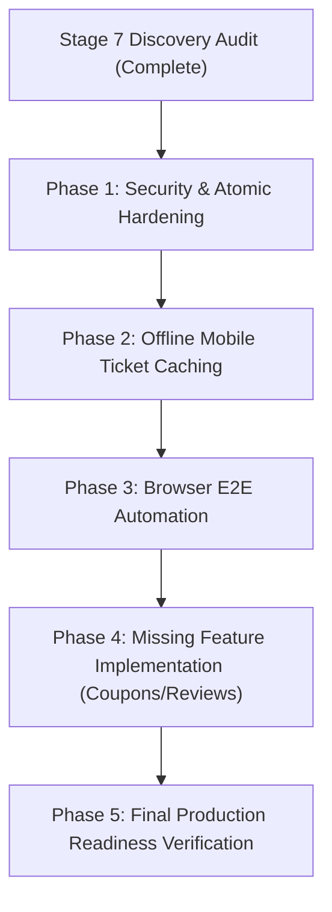

# Master Product Discovery & Architectural Audit Report: Cluvo Platform (Stage 7)

**Audit Date**: November 1, 2026  
**Repositories Audited**:  
- `shivapraneeth14/oragnizer-web` (Web Applications & Supabase Backend)  
- `shivapraneeth14/cluvo` (`apps/mobile` — Flutter Customer Application)  
**Branch**: `dev`  
**Audit Role**: Principal Software Architect, Senior QA Engineer, Database Architect & Application Security Auditor  
**Audit Mode**: PLAN MODE / READ-ONLY DISCOVERY ONLY  

---

## 1. Executive Summary

A comprehensive, read-only product discovery audit was performed across the entire Cluvo codebase. The objective was to discover every feature, screen, route, service, database function, integration, and security constraint across the platform.

### Summary of Platform Metrics
- **Total Features Discovered**: **93 Features**
  - **`IMPLEMENTED`**: **87 Features (93.5%)**
  - **`PARTIALLY IMPLEMENTED`**: **2 Features (2.2%)**
  - **`MISSING`**: **4 Features (4.3%)**
  - **`NOT VERIFIED`**: **0 Features (0.0%)**
- **Total Screens & Routes Discovered**: **34 Unique Screens & Routes**
  - Customer Mobile App: 16 Screens, 18 Routes
  - Organizer Web Portal: 7 Top-level Pages/Tabs, 6 Modal Overlays
  - Admin Web Portal: 11 Pages, 13 Routes
- **Backend Database Architecture**:
  - **35 Tables** defined across migrations
  - **72+ PostgreSQL Functions & RPCs**
  - **46 Supabase Edge Functions**
  - **138 Database Migration Files**
  - **4 Active Cron Jobs**
- **Existing Automated Test Suite**:
  - **87 Test Files** across the repositories
  - **669+ Individual Tests** (310 Deno tests, 163 Flutter tests, 90+ PostgreSQL concurrency tests, 66 Vitest web tests, 35+ smoke scripts, 5 Playwright tests)

---

## 2. Repository Architecture & Directory Hierarchy

The Cluvo codebase is organized as a unified monorepo for web and backend, with the Flutter customer app hosted as an embedded git submodule/sub-repository in `apps/mobile`:

```
community/ (shivapraneeth14/oragnizer-web)
├── apps/
│   ├── admin-web/            # React 18 + Vite + Tailwind admin console
│   ├── organizer-web/        # React 18 + Vite + Tailwind organizer console
│   └── mobile/               # Flutter (shivapraneeth14/cluvo) iOS & Android app
├── packages/
│   ├── shared/               # Shared TypeScript types, formatters, validation
│   ├── ui/                   # Shared UI component primitives
│   └── config/               # Shared Tailwind & TypeScript configurations
├── supabase/
│   ├── migrations/           # 138 forward SQL migrations
│   ├── functions/            # 46 Deno Edge Functions + _shared libraries
│   └── tests/                # 37 Deno test files (310 tests)
├── tests/                    # Multi-connection Node.js PostgreSQL concurrency tests
├── scripts/                  # Automated smoke & milestone verification scripts
└── audit/                    # Comprehensive Stage 5, 6, and 7 audit artifacts
```

---

## 3. Customer Mobile Application Inventory (`apps/mobile`)

The Customer Mobile App is developed in Flutter using Riverpod for state management and GoRouter for deep-linkable declarative routing.

### Discovered Screens & Routes
1. `/splash` $\to$ `SplashScreen`: Launch screen, initial location detection, and auth session hydration.
2. `/login` & `/signup` $\to$ `LoginScreen`: Email/password authentication, Google OAuth sign-in button.
3. `/consent` $\to$ `ConsentGateScreen`: Mandatory Privacy Policy and Terms of Service consent gate.
4. `/home` $\to$ `HomeScreen`: Featured event hero, trending pills, categories, quick filters, free event banner.
5. `/search` $\to$ `SearchScreen`: Full-text event and community search with category chips and location picker.
6. `/communities` $\to$ `CommunitiesScreen`: Grid of recommended and trending public communities.
7. `/communities/all` $\to$ `CommunitiesBrowseScreen`: Paginated community directory.
8. `/communities/:id` $\to$ `CommunityDetailScreen`: Community profile, cover image, member count, media grid, event roster, and join/leave button.
9. `/events` $\to$ `EventsScreen`: Categorized event listing with location distance calculation.
10. `/events/all` $\to$ `EventsBrowseScreen`: Paginated event directory.
11. `/events/:id` $\to$ `EventDetailScreen`: Comprehensive event overview, seat availability, discussion chat, wishlist toggle, and booking/cancellation buttons.
12. `/dine` $\to$ `DineScreen`: Placeholder screen ("Coming soon.").
13. `/profile` $\to$ `ProfileScreen`: Attendee profile, account deletion grace period management, theme switch.
14. `/profile/communities` $\to$ `MyCommunitiesScreen`: Communities joined by current attendee.
15. `/profile/registrations` $\to$ `MyRegistrationsScreen`: Confirmed and attended ticket passes.
16. `/profile/payments` $\to$ `MyPaymentsScreen`: List of captured payments and issued refunds.
17. `/profile/wishlist` $\to$ `WishlistScreen`: Saved event bookmarks.
18. `/ticket/:id` $\to$ `TicketScreen`: Event ticket pass rendering 256-bit CSPRNG QR code and check-in status.
19. `/payments/:id` $\to$ `PaymentDetailScreen`: Detailed breakdown receipt for a payment transaction.
20. `/refunds/:id` $\to$ `PaymentDetailScreen`: Isolated refund receipt with Razorpay refund identifier.
21. `/notifications` $\to$ `NotificationsScreen`: Realtime in-app notification center.
22. `/edit-profile` $\to$ `EditProfileScreen`: Update name, username, and profile avatar.

---

## 4. Organizer Web Application Inventory (`apps/organizer-web`)

The Organizer Portal is a responsive single-page application built on React 18, React Router v6, Tailwind CSS, and HTML5 QR code scanning.

### Discovered Pages & Components
1. `/` $\to$ `LandingPage`: Email-first login, Google OAuth, organizer marketing copy.
2. `/privacy` $\to$ `PrivacyPolicyPage`: Public legal privacy terms.
3. `/terms` $\to$ `TermsPage`: Public platform terms and fee rules.
4. `/dashboard` $\to$ `DashboardPage`: Protected master shell with hash-routed tabs:
   - `#dashboard` $\to$ Overview: Upcoming event countdown, member count, shareable community links.
   - `#events` $\to$ `EventList`, `EventForm`, `EventDetail`: Create/edit event, manage capacities, cancel event dialog, cancellation queue progress modal.
   - `#members` $\to$ `MemberRow`: View community members and role indicators.
   - `#media` $\to$ `MediaSection`, `VideoPreviewModal`: Cloudinary photo/video uploads, gallery, and deletion.
   - `#payout` $\to$ `PayoutSection`: Financial statement, event sales breakdown, manual settlement confirmation & dispute filing.
   - `#check-in` $\to$ `CheckInPage`, `ScanModal`, `ManualLookup`, `StatsCards`: Live camera QR scanner and attendee ticket check-in.
   - `#settings` $\to$ `SettingsPage`, `PaymentAccounts`, `Privacy`, `EditProfile`, `SocialMedia`: Manage bank beneficiary accounts (account number/IFSC), profile details, social links.
5. Onboarding Overlay $\to$ `CommunityDetailsForm`: 2-step onboarding form for unapproved organizers.
6. Waiting Overlay $\to$ `WaitingForApproval`: Verification state showing pending review or admin rejection notes.

---

## 5. Admin Web Application Inventory (`apps/admin-web`)

The Administrative Portal provides platform oversight, moderation, user management, and financial control.

### Discovered Pages & Features
1. `/` $\to$ `LoginPage`: Secure admin login verifying `profiles.is_admin = true`.
2. `/forgot-password` $\to$ `ForgotPasswordPage`: Password recovery OTP dispatch.
3. `/reset-password` $\to$ `ResetPasswordPage`: Password reset entry with OTP token validation.
4. `/dashboard` $\to$ `DashboardPage`: Platform KPI overview (users, communities, events, revenue).
5. `/communities` $\to$ `CommunitiesPage`: Application approval queue, community directory, search, close community.
6. `/communities/:id` $\to$ `CommunityDetailPage`: Detailed community inspector, event roster, deletion grace actions.
7. `/users` $\to$ `UsersPage`: User directory with search and role filters.
8. `/users/:id` $\to$ `UserDetailPage`: User profile, promote/demote administrator, initiate/cancel account deletion.
9. `/events` $\to$ `EventsPage`: Platform event listing across all communities with status filters.
10. `/events/:id` $\to$ `EventDetailPage`: Detailed event attendee roster, sales revenue, cancel event action.
11. `/financials` $\to$ `FinancialsPage`: Consolidated passbook ledger, 3-way reconciliation engine, record manual payout modal, dispute resolution modal, adopt provider refund modal, offline manual settlement modal.
12. `/alerts` $\to$ `AlertsPage`: Realtime operational alerts (payment anomalies, refund spikes).
13. `/reports` $\to$ `ReportsPage`: UGC content reports moderation, dismiss report, ban user.

---

## 6. Supabase Backend Architecture

### Tables Catalog (35 Tables)
- Core Users & Identity: `profiles`, `auth.users`, `consent_log`, `password_reset_otps`, `user_blocks`.
- Communities & Teams: `communities`, `community_members`, `community_beneficiaries`, `community_applications`.
- Events & Tickets: `events`, `registrations`, `wishlist`, `event_messages`, `event_restricted_users`.
- Payments & Ledgers: `payments`, `payment_audit_log`, `payout_items`, `payment_refund_history`, `processed_webhooks`, `rate_limits`.
- Cancellation Engine: `event_cancellation_jobs`, `refund_task_queue`.
- Media & Outbox: `media`, `media_cleanup_jobs`.
- System & Moderation: `admin_alerts`, `content_reports`, `audit_log`, `notifications`.
- Legacy / Inactive: `plans`, `community_subscriptions`, `coupons`, `reviews`, `waitlist_entries`, `payment_transfers`, `reports`, `join_requests`.

### Key PostgreSQL RPC Functions (Security Definer)
- Payment & Ticket Holds: `reserve_ticket_capacity`, `release_ticket_capacity`, `confirm_payment`, `confirm_payment_from_webhook`, `register_free_event`.
- Refunds & Cancellations: `cancel_registration_and_claim_refund`, `claim_payment_refund`, `cancel_registration_and_decrement`, `cancel_event_and_enqueue_refunds`, `claim_refund_tasks`, `admin_adopt_provider_refund`, `admin_manual_settlement`.
- Settlements & Wallets: `admin_record_manual_payout`, `organizer_confirm_manual_payout`, `organizer_dispute_manual_payout`, `admin_resolve_payout_dispute`, `admin_cancel_manual_payout`, `run_financial_reconciliation`.
- Gate & Check-In: `check_in_registration`.
- Reporting & Statements: `get_admin_financial_statement`, `get_organizer_financial_statement`, `get_financial_observability_kpis`, `get_admin_profiles`, `get_admin_communities`.

### Edge Functions (46 Functions)
- Core Lifecycle: `create-payment`, `verify-payment`, `verify-payment-webhook`, `register-for-event`, `cancel-registration`, `cancel-event`, `process-cancellation-queue`, `check-in`.
- Admin & Approvals: `admin-adopt-refund`, `notify-community-approval`, `admin-delete-community`, `admin-delete-user`, `admin-undelete-user`, `admin-list-profiles`.
- Operations & Maintenance: `reconcile-payments`, `purge-deleted-accounts`, `delete-media`, `delete-account`, `cancel-account-deletion`, `record-consent`, `forgot-password`, `verify-otp`, `change-password`.

---

## 7. External Third-Party Integrations

1. **Razorpay**:
   - Orders API (`POST /v1/orders`) for checkout order generation.
   - Payments API (`GET /v1/payments/:id`) for status verification.
   - Refunds API (`POST /v1/payments/:id/refunds`) for self-cancellation and bulk refunds.
   - Webhooks API for server-side `payment.captured` confirmation.
   - Frontend Checkout SDKs for mobile and web.
2. **Cloudinary**:
   - Direct image and video uploads from mobile and web client.
   - Server-side asset destruction via `api.cloudinary.com/v1_1/<cloud>/image/destroy` and `video/destroy`.
3. **OpenStreetMap / Nominatim / Photon**:
   - Venue geocoding and coordinates lookup.
   - Reverse geocoding for device location matching.
4. **Resend / Supabase Auth Email**:
   - Transactional emails for password reset OTPs.
5. **Firebase Cloud Messaging / Supabase Realtime**:
   - Realtime WebSocket channels for in-app notifications and discussion chat.

---

## 8. Security Findings & Architectural Vulnerabilities

During discovery, three technical concerns were identified:

### Finding SEC-01: Non-Atomic Cancellation in Customer Self-Service Route
- **Severity**: **HIGH**
- **Location**: `supabase/functions/cancel-registration/index.ts` (lines 128–141).
- **Issue**: The `cancel-registration` Edge Function executes `cancel_registration_and_decrement` first, and then executes `attemptRefund` in TypeScript code. If the Edge Function experiences a runtime timeout or crash between these calls, the ticket is cancelled and capacity decremented, but the refund claim is not committed.
- **Remediation**: Update `cancel-registration/index.ts` to call the composite RPC `cancel_registration_and_claim_refund` (introduced in migration `202611010014`), which coordinates cancellation, capacity decrement, and refund claiming in a single atomic database transaction.

### Finding SEC-02: Missing Access Controls on Legacy Coupon RPCs
- **Severity**: **MEDIUM**
- **Location**: `supabase/migrations/202607300012_coupon_atomic_claim.sql`.
- **Issue**: The database contains `claim_coupon` and `release_coupon` functions, but coupons are not implemented in the mobile or web UI. These functions have public execute grants without caller ownership checks.
- **Remediation**: Explicitly revoke execute grants from `anon` and `public` on `claim_coupon` and `release_coupon` until the coupon subsystem is fully designed.

### Finding SEC-03: Unsigned Direct Cloudinary Uploads
- **Severity**: **MEDIUM**
- **Location**: `apps/mobile/lib/services/cloudinary.dart` & `apps/organizer-web/src/lib/cloudinary.ts`.
- **Issue**: Media uploads use unsigned Cloudinary upload presets. If the preset is misconfigured, arbitrary media files could be uploaded to the Cloudinary account.
- **Remediation**: Implement an authenticated Edge Function `create-cloudinary-signature` to enforce signed uploads and strictly validate MIME types.

---

## 9. Reliability Findings & Operational Risks

### Finding REL-01: Missing Offline Caching for Mobile Ticket Pass
- **Severity**: **HIGH**
- **Location**: `apps/mobile/lib/screens/ticket_screen.dart`.
- **Issue**: When an attendee arrives at a crowded venue with poor cellular connectivity, `TicketScreen` attempts to query Supabase over the network. If the request fails, the ticket QR code cannot be displayed.
- **Remediation**: Implement local SQLite / Hive caching via `SecureLocalStorage` so confirmed ticket passes and QR tokens are cached offline.

### Finding REL-02: Absence of End-to-End Browser Workflow Tests
- **Severity**: **MEDIUM**
- **Location**: `e2e/`.
- **Issue**: The `e2e/` folder contains only a single responsive layout test (`responsive.spec.ts`). There are no end-to-end browser tests verifying the complete user journey (event creation $\to$ attendee booking $\to$ check-in $\to$ settlement).
- **Remediation**: Build a Playwright test suite simulating the complete organizer and attendee lifecycle.

---

## 10. Missing Functionality Inventory

The discovery identified four functional areas that are referenced in schemas, blueprints, or legal policies but lack operational implementation:

1. **Promotional Coupons & Discounts**:
   - Backend schema and claim RPCs exist, but there is no UI in Organizer Web to create coupons, and no coupon code input field in Mobile checkout.
2. **Event Reviews and Ratings**:
   - `reviews` table exists in database schema and is mentioned in privacy policies, but there is no screen or modal for attendees to rate events or read reviews.
3. **Event Waitlist**:
   - `waitlist_entries` table exists in database schema, but there is no option for attendees to join a waitlist when capacity is exhausted.
4. **Dine Discovery**:
   - Mobile navigation includes a "Dine" tab, but it opens a static placeholder screen displaying "Coming soon.".

---

## 11. Recommended Implementation Order for Stage 7

To advance Cluvo to complete product maturity, the recommended execution order is:

1. **Milestone 1 — Security & Transaction Hardening**:
   - Migrate `cancel-registration/index.ts` to call composite `cancel_registration_and_claim_refund`.
   - Revoke public grants on unused coupon RPCs.
2. **Milestone 2 — Offline Mobile Resilience**:
   - Add local offline caching for ticket passes in `apps/mobile`.
3. **Milestone 3 — End-to-End Browser Automation**:
   - Implement complete Playwright E2E suites for booking, check-in, and manual settlements.
4. **Milestone 4 — Feature Completeness**:
   - Implement coupon creation and redemption flow across organizer web and mobile app.
   - Implement event reviews and attendee feedback ratings.
   - Complete or retire the Dine placeholder screen.

---

## 12. Proposed Stage 7 Execution Roadmap



